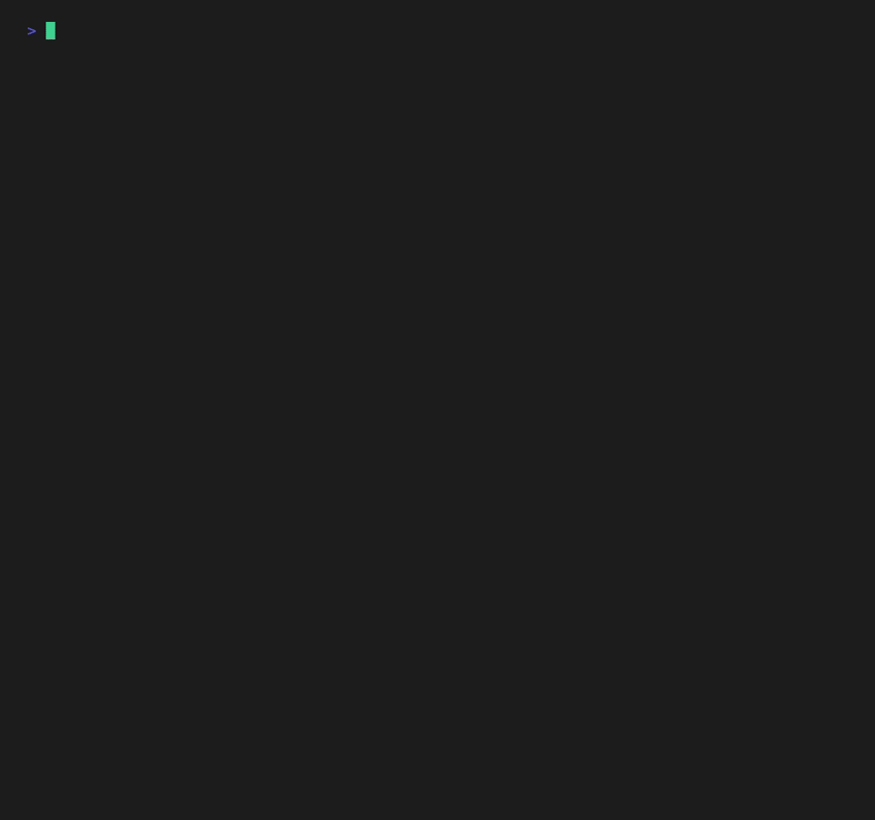

<h1 align="center">@supabase/tui</h1>

<p align="center">
  Terminal UIs for the Supabase CLI, built on <a href="https://foldkit.dev">Foldkit</a>'s architecture.
</p>

<p align="center">
  
</p>

<p align="center">
  <a href="#try-it">Try it</a> ·
  <a href="#a-first-program">A first program</a> ·
  <a href="#layout">Layout</a> ·
  <a href="#blocks">Blocks</a> ·
  <a href="#theme">Theme</a> ·
  <a href="docs/building-blocks.md">Building blocks guide</a>
</p>

> [!NOTE]
> This package is a private prototype, and its API may change.

A program is a `Model`, a `Message` union, an `update` function and a `view`, as in any Foldkit
program. Views return a `Node` tree instead of HTML, and layout is flexbox in terminal cells,
computed by Yoga. Import the package as `@supabase/tui` from this workspace.

## Try it

1. Set up the repository once, as [CONTRIBUTING.md](../../CONTRIBUTING.md#installing-mise)
   describes: `mise install` provides the pinned Node, Bun and pnpm.
2. Run `pnpm install` from the repository root.
3. From `packages/tui`, in an interactive terminal, run a demo:

```sh
bun examples/gallery.ts   # every block, then live spinners and a prompt
bun examples/counter.ts   # up/down or +/- change a count, q quits
bun examples/counters.ts  # several counters in one program
```

On a pipe, the gallery prints its static screen and stops.

### Change how it looks

Edit one of these files and rerun the gallery:

| File                                                               | What it controls                                                                              |
| ------------------------------------------------------------------ | --------------------------------------------------------------------------------------------- |
| [`src/supabase/theme.ts`](src/supabase/theme.ts)                   | The color of each [tone](#theme), with 256-color and 16-color fallbacks                       |
| [`src/blocks/glyphs.ts`](src/blocks/glyphs.ts)                     | The symbols the blocks draw, such as ticks, pointers and radio buttons, with ASCII alternates |
| [`src/examples/gallery/static.ts`](src/examples/gallery/static.ts) | The gallery screen; add a `section(...)` to show a block in another state                     |

Read [Theme and legibility](docs/building-blocks.md#theme-and-legibility) before changing colors.
The recording above comes from [`docs/gallery.tape`](docs/gallery.tape); after a visual change,
rerun it with [VHS](https://github.com/charmbracelet/vhs): `vhs docs/gallery.tape` from
`packages/tui`.

## A first program

A program needs a model, messages, an update function, a view and a way to receive keys. This one
counts with the arrow keys and finishes with the count when you press `q`.

```ts
import { NodeRuntime } from "@effect/platform-node";
import { Console, Effect, Match, Option, Schema } from "effect";
import { defineMessageUnion } from "foldkit/message";
import { defineTaggedUnion } from "foldkit/schema";
import { modifyFields } from "foldkit/struct";
import * as Subscription from "foldkit/subscription";
import type * as Update from "foldkit/update";

import { isModified, Key, Terminal, Tui, View } from "@supabase/tui";

const Lifecycle = defineTaggedUnion({ Counting: {}, Finished: {} });

const Model = Schema.Struct({ count: Schema.Finite, lifecycle: Lifecycle });
type Model = typeof Model.Type;

const Message = defineMessageUnion({
  PressedKey: { key: Key },
});
type Message = typeof Message.Type;

const update = (model: Model, message: Message) =>
  Message.match<Update.Return<Model, Message>>(message, {
    PressedKey: ({ key }) => ({
      model: isModified(key)
        ? model
        : Key.matchOrElse(
            key,
            {
              Up: () => modifyFields(model, { count: (count) => count + 1 }),
              Down: () => modifyFields(model, { count: (count) => count - 1 }),
              Char: ({ text }) =>
                Match.value(text).pipe(
                  Match.when("q", () =>
                    modifyFields(model, { lifecycle: () => Lifecycle.Finished() }),
                  ),
                  Match.orElse(() => model),
                ),
            },
            () => model,
          ),
    }),
  });

const view = (model: Model) =>
  View.screen(
    View.column([
      View.text("Counter", { emphasis: "bold" }),
      View.text(String(model.count)),
      View.text("up/down change  q quit", { tone: "muted" }),
    ]),
  );

const subscriptions = Subscription.make<Model, Message, Tui.Keys>()(() => ({
  keys: Tui.keyEntry((key) => Message.PressedKey({ key })),
}));

const program = Tui.makeProgram({
  Model,
  init: () => ({ model: { count: 0, lifecycle: Lifecycle.Counting() } }),
  update,
  view,
  subscriptions,
  result: (model) =>
    Lifecycle.match(model.lifecycle, {
      Counting: () => Option.none(),
      Finished: () => Option.some(model.count),
    }),
});

const main = Effect.fn("counter")(function* () {
  const count = yield* Tui.run(program);
  yield* Console.log(`final count: ${count}`);
});

main().pipe(Effect.provide(Terminal.layerProcess()), NodeRuntime.runMain);
```

- `result` returns `Option.some(value)` when the program is finished. `Tui.run` then resolves with
  that value.
- `View.screen(live, committed?)` wraps what a view returns. The `live` node is redrawn in place;
  `committed` nodes are appended to scrollback once. `committed` is cumulative and append-only:
  every view returns all the committed nodes so far, the writer appends only the entries beyond the
  previous count, and a shorter list is a defect.
- `Terminal.layerProcess()` gives the program a terminal. When stdin closes (EOF) before `result`
  returns a value, the run is interrupted (exit code 130), like Ctrl+C.
- A view may take a second argument, the `Tui.Viewport`: the drawable size in cells. Live output
  reserves the last column and the last row for the cursor, so the viewport is one smaller than the
  terminal in both directions; `rows` budgets the live region and the final frame can exceed it and
  scroll.
- One run owns a terminal's input at a time. A second concurrent run on the same terminal fails at
  once with `TerminalError` reason `busy`. While a run is active, other writes to the same TTY
  corrupt the live region, so log through committed nodes.

The architecture is Foldkit's, so programs import `foldkit/message`, `foldkit/struct`,
`foldkit/subscription` and `foldkit/update` directly.

The full version is [`src/examples/counter/main.ts`](src/examples/counter/main.ts).

## Keys

A `Key` is a tagged union: `Char`, `Enter`, `Tab`, `ShiftTab`, `Backspace`, `Delete`, `Escape`, the
arrows, `Home`, `End`, `PageUp`, `PageDown`, `Ctrl` and `Eof`. Modifiers are data on the key: `meta`
(Option or Alt) on `Char`, `Enter`, `Tab`, `Backspace` and `Ctrl`, and optional `shift`, `ctrl` and
`meta` on the navigation and editing keys when the terminal reports them. `isModified(key)` is true
for any key pressed with a modifier. A shortcut should return early on a modified key, so `Alt+-` is
not read as `-`.

## Layout

`View.row` and `View.column` take the same options. Sizes are terminal cells.

| Option                             | Meaning                                                                   |
| ---------------------------------- | ------------------------------------------------------------------------- |
| `gap`                              | Cells between children                                                    |
| `padding`                          | `n`, `{ x, y }` or `{ top, right, bottom, left }`                         |
| `border`                           | `"single"`, `"rounded"` or `{ style, tone }`                              |
| `width`                            | Cells, or a percentage such as `"50%"` of the parent's width              |
| `minWidth`, `maxWidth`             | Cell bounds on width                                                      |
| `height`, `minHeight`, `maxHeight` | Cell sizes on height                                                      |
| `basis`, `grow`, `shrink`          | Flex factors on the main axis                                             |
| `justify`                          | `start`, `center`, `end`, `space-between`, `space-around`, `space-evenly` |
| `align`, `alignSelf`               | `start`, `center`, `end`, `stretch` (`alignSelf` also `auto`)             |
| `wrap`                             | Flow children onto new lines                                              |

`View.text(content, { tone, emphasis, wrap })` draws text. Pass an array of `View.span(...)` or
`View.glyph(...)` items to style parts of a line. `View.glyph(value, style)` is a span that carries a
unicode character and an ASCII alternate; layout writes the one the terminal supports, so programs
never read capabilities. `View.spacer()` takes the leftover space of its
parent, so it pushes the siblings after it to the end.

A panel that narrows with the terminal is `width: "100%", maxWidth: 80`: 80 cells on a wide
terminal, the full width on a narrow one. This example combines a header row, a spacer-pushed
status and a bordered panel holding a KeyValue:

```ts
const layout = () =>
  View.column([
    View.row([
      View.text("my-project", { emphasis: "bold" }),
      View.spacer(),
      View.text([View.glyph({ unicode: "✔", ascii: "+" }, { tone: "success" }), " healthy"]),
    ]),
    View.column(
      [
        KeyValue.view({
          entries: [
            { key: "Region", value: "eu-west-1" },
            { key: "Database", value: "postgres 17" },
          ],
          tone: "accent",
        }),
      ],
      { border: "rounded", padding: { x: 1 }, width: "100%", maxWidth: 80 },
    ),
  ]);
```

It renders as:

```text
my-project                                                             ✔ healthy
╭──────────────────────────────────────────────────────────────────────────────╮
│ • Region   eu-west-1                                                         │
│ • Database postgres 17                                                       │
╰──────────────────────────────────────────────────────────────────────────────╯
```

## Blocks

Blocks are ready-made pieces of UI. Each is exported as a namespace.

| Block      | Kind      | What it does                                                                                                                                                  |
| ---------- | --------- | ------------------------------------------------------------------------------------------------------------------------------------------------------------- |
| `KeyValue` | Stateless | `KeyValue.view({ entries, tone? })` aligns bold keys beside values. It needs a parent with a definite width.                                                  |
| `Spinner`  | Submodel  | `Spinner.view(model, { label, status, tone })` animates while `running` and shows a glyph once `succeeded`, `failed` or `warning`.                            |
| `Select`   | Submodel  | A scrolling radio list: `Select.init(options)`, `Select.view(model, { message, rows })`.                                                                      |
| `Prompt`   | Effect    | `Prompt.select` runs `Select` as a one-shot program and returns the chosen value. It fails with `Prompt.NonInteractive` when the terminal is not interactive. |

```ts
const chooseRegion = Effect.gen(function* () {
  const region = yield* Prompt.select({
    message: "Which region?",
    options: [
      { value: "us-east-1", label: "East US", hint: "closest" },
      { value: "eu-west-1", label: "West EU" },
    ],
  });
  yield* Console.log(`deploying to ${region}`);
});
```

## Theme

Blocks color their output by tone, never by raw color. The default theme is neutral: it uses the
terminal's own 16 colors, so output follows the user's terminal theme. Supabase entry points, and
the demos in `examples/`, provide the brand colors with `Effect.provide(Theme.layer(supabaseTheme))`.

| Tone      | Supabase color | Use for                                |
| --------- | -------------- | -------------------------------------- |
| `default` | Terminal text  | All text that carries meaning          |
| `muted`   | `#898989`      | Hints a reader can skip                |
| `accent`  | `#3ECF8E`      | Brand highlights and the active choice |
| `success` | `#3ECF8E`      | Completed steps                        |
| `warning` | `#DB8E00`      | Things that need attention             |
| `danger`  | `#E54D2E`      | Failures                               |
| `info`    | `#7A66FF`      | Informational notes                    |

Use tones for glyphs, borders and decoration, and pair color with a glyph or a word so it never
carries meaning on its own. The Supabase colors are tuned for dark backgrounds; the
[guide](docs/building-blocks.md#theme-and-legibility) explains the rules. Glyphs are not part of the
theme: each block owns a glyph table in [`src/blocks/glyphs.ts`](src/blocks/glyphs.ts), drawn with
`View.glyph`.

## Architecture

The renderer (`src/terminal`, `src/runtime`, `src/view`, `src/theme`, `src/capabilities.ts`) has no
Supabase knowledge and is written to be lifted into a standalone terminal package. Each renderer
module exposes one `public.ts` barrel. The Supabase layer (`src/blocks`, `src/supabase`,
`src/examples`, the demos in `examples/` and the facade `src/index.ts`) imports the renderer only
through those barrels, and the root `.oxlintrc.json` fails an import that crosses the line in either
direction. Tests reach the renderer through the barrels plus the harness in
[`src/terminal/testing.ts`](src/terminal/testing.ts) (exported as `@supabase/tui/testing`) and
[`src/runtime/test-support.ts`](src/runtime/test-support.ts).

## Where next

[`docs/building-blocks.md`](docs/building-blocks.md) is the guide for block authors:

- [Submodel exports](docs/building-blocks.md#submodel-exports): what a stateful block exports.
- [Parent composition](docs/building-blocks.md#parent-composition): embedding blocks in a program.
- [Layout](docs/building-blocks.md#layout): sizing rules and limits.
- [Add a gallery entry](docs/building-blocks.md#add-a-gallery-entry): show a block in the gallery.
- [Add a story test](docs/building-blocks.md#add-a-story-test): test a block as a user would.

The public API is the `public.ts` barrel of each renderer module
([`terminal`](src/terminal/public.ts), [`runtime`](src/runtime/public.ts),
[`view`](src/view/public.ts), [`theme`](src/theme/public.ts)) and the blocks;
[`src/index.ts`](src/index.ts) exposes them as the `Terminal`, `Key`, `Tui`, `View` and `Theme`
namespaces plus the blocks.
